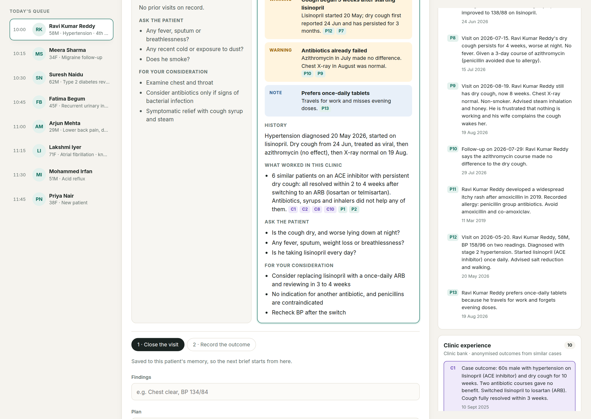

# Clinic Desk

**A doctor's assistant that remembers every patient, and learns what actually worked across the whole clinic.**

A family doctor sees 40 patients a day and has about 20 seconds to remember each one's history before they walk in. The history is scattered across paper, old prescriptions and the doctor's own memory. So the same mistakes repeat: a third antibiotic for a cough that was never an infection, a painkiller for a patient on blood thinners, a drug the patient is allergic to.

Clinic Desk reads today's complaint, recalls the patient's own chart **and** what worked for similar patients in the same clinic, then gives the doctor a cited, 20-second brief.

Built on [Hindsight](https://github.com/vectorize-io/hindsight) agent memory, Groq, and Next.js.



---

## The before / after

Ravi, 58, comes in for the fourth time with a dry cough and asks for a stronger antibiotic.

| Without memory | With Clinic Desk |
| --- | --- |
| "Likely post-viral cough. Consider antibiotics if bacterial signs. Cough syrup and steam." | **Critical:** penicillin allergy, avoid amoxicillin. **Warning:** cough started 5 weeks after lisinopril was prescribed. **Warning:** azithromycin already failed, X-ray normal. **What worked here:** 6 similar patients on ACE inhibitors resolved within 2 to 4 weeks after switching to an ARB. |

Every claim is cited (`P3`, `C2`) back to the exact memory it came from. Hover a citation and the memory lights up.

## How Hindsight memory is used

Clinic Desk uses **two memory banks** and reasons over both at once.

```
                 today's complaint
                        │
        ┌───────────────┴────────────────┐
   recall()                           recall()
 PATIENT bank                        CLINIC bank
 (tag: patient:P001,                 (anonymised case outcomes,
  any_strict scoping)                 observations preferred)
        └───────────────┬────────────────┘
                   reason (Groq)
                        │
        cited brief: flags, history, what worked
                        │
          doctor closes the visit + records outcome
                        │
        retain() ──► patient bank  (the chart)
        retain() ──► clinic bank   (anonymised, so the next patient benefits)
```

| Hindsight feature | Where | Why |
| --- | --- | --- |
| `createBank` with `reflectMission` / `retainMission` | `lib/hindsight.ts` | Tells Hindsight to extract clinical facts (drugs, dates, outcomes) and to never guess |
| `retain` with `tags`, `timestamp`, `documentId` | `lib/memory.ts` → `retainVisit`, `retainOutcome` | Every memory is dated and tagged to one patient |
| `recall` with `tags` + `tagsMatch: "any_strict"` | `recallPatient` | A patient's recall can never leak another patient's chart |
| Two parallel recalls per patient | `recallPatient` | One shaped by the complaint, one that always pulls allergies and current meds, so safety facts surface even when unrelated to the complaint |
| `recall` with `types: ["observation","world"]`, `preferObservations` | `recallClinic` | Hindsight consolidates many similar case outcomes into observations, so "6 patients improved on an ARB" is one strong signal, not six noisy ones |
| `reflect` with `includeFacts` | `askChart`, `askClinic` | "Ask the memory" box: free questions over one chart or the whole clinic |
| Closing the loop | `retainOutcome` | Writes the result to the chart **and** (anonymised) to clinic memory. This is what makes the agent better over time. |

### Why it gets better over time

1. **Interaction 1** (new patient, Priya): no chart, so the brief is generic but still uses clinic experience.
2. **Interaction 5** (Ravi): the chart shows the failed antibiotic and the lisinopril timing.
3. **Every recorded outcome** adds evidence to clinic memory. The next patient on an ACE inhibitor with a cough gets a stronger, better-supported recommendation.

## Run it

**Requirements:** Node 18.18+, a [Hindsight Cloud](https://ui.hindsight.vectorize.io) account (or a self-hosted server), a free [Groq](https://console.groq.com/keys) key.

```bash
git clone https://github.com/vedant7007/clinic-desk.git
cd clinic-desk
npm install
cp .env.example .env.local     # add HINDSIGHT_API_KEY and GROQ_API_KEY
npm run seed                   # loads 8 patients + 26 anonymised clinic outcomes
npm run check                  # end-to-end test: prints a brief for Ravi
npm run dev                    # http://localhost:3000
```

Re-running `npm run seed` is safe: each batch uses a stable document id, so it replaces instead of duplicating.

## Project layout

```
app/
  page.tsx              queue, consultation, memory panel
  api/brief             recall both banks + reason → brief (with/without memory)
  api/visit             retain today's visit to the patient bank
  api/outcome           retain outcome to patient bank + anonymised to clinic bank
  api/ask               reflect over a chart or the whole clinic
lib/
  hindsight.ts          client + bank setup (missions)
  memory.ts             every retain / recall / reflect call lives here
  brief.ts              the agent: recall → reason → cited brief
  llm.ts                Groq JSON calls with validation, retries, model fallback
data/
  patients.ts           today's queue (display only)
  seed-memories.ts      synthetic chart history and clinic outcomes
scripts/
  seed.ts, check.ts
```

## Edge cases handled

- **Patient isolation:** strict tag scoping on every patient recall and reflect.
- **Anonymisation:** patient names are stripped before anything reaches the clinic bank; only age band and sex are kept.
- **Hallucinated citations:** any reference the model invents that was not in the recalled set is dropped.
- **Malformed model output:** JSON is schema-validated with zod; the primary model is retried, then a fallback model (`qwen/qwen3-32b`) is used. `<think>` blocks and code fences are stripped.
- **New patients:** an empty chart produces an honest "no history" brief instead of invented history.
- **Missing keys:** the UI shows exactly which environment variable is missing.
- **Input validation:** every API route validates and length-limits its input.

## Safety

Clinic Desk is decision support. It never gives a final diagnosis and never suggests doses. The doctor decides. All patients and records in this repository are synthetic.

## Links

- [Hindsight on GitHub](https://github.com/vectorize-io/hindsight)
- [Hindsight documentation](https://hindsight.vectorize.io/)
- [What is agent memory?](https://vectorize.io/what-is-agent-memory)

MIT licensed.
