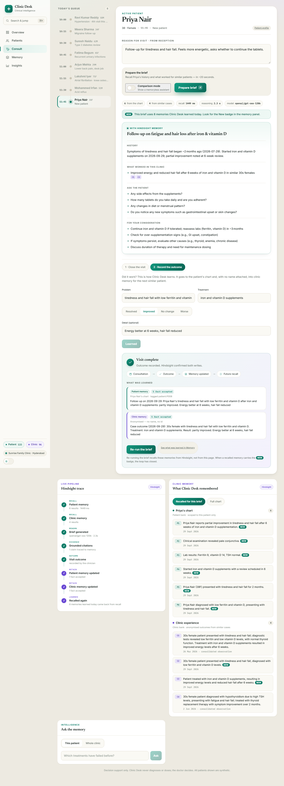

# Clinic Desk

**A doctor's assistant that remembers every patient, and learns what actually worked across the whole clinic.**

A family doctor sees 40 patients a day and has about 20 seconds to remember each one's history before they walk in. The history is scattered across paper, old prescriptions and the doctor's own memory. So the same mistakes repeat: a third antibiotic for a cough that was never an infection, a painkiller for a patient on blood thinners, a drug the patient is allergic to.

Clinic Desk reads today's complaint, recalls the patient's own chart **and** what worked for similar patients in the same clinic, then gives the doctor a cited, 20-second brief. After the visit the doctor records the plan and whether it worked. Both are written back to memory, so the next brief for this patient, and for every similar patient, is better than the last.

It is built on [Hindsight](https://github.com/vectorize-io/hindsight), an open-source agent memory system, with Groq for reasoning and Next.js 15 for the app. If you are new to the idea, Vectorize has a good primer on [what agent memory is](https://vectorize.io/what-is-agent-memory) and why it differs from plain retrieval.


---

## The before and after

Ravi, 58, comes in for the fourth time with a dry cough and asks for a stronger antibiotic.

| Without memory | With Clinic Desk |
| --- | --- |
| "Chronic dry cough, rule out TB, GERD, asthma. Avoid empirical antibiotics." | **Critical:** penicillin allergy, and he is asking for an antibiotic. **Warning:** lisinopril started 2026-05-20, the cough began 2026-06-17. **Warning:** azithromycin already failed. **What worked here:** six similar patients on ACE inhibitors resolved after switching to an ARB. |

Every claim is cited back to the exact memory it came from (`P5` for the patient's chart, `C2` for a clinic case, `today` for the complaint itself). Hover or focus a citation and the memory lights up in the side panel.

## Watch it learn



1. **Priya, first visit.** No chart, so the brief says so, raises no invented history, and leans on two anonymised clinic cases (low ferritin, hypothyroidism).
2. **Close the visit and record the outcome.** The plan goes to her chart; the outcome goes to her chart and, with her name stripped, to clinic memory.
3. **Re-run the brief.** It now cites her own labs and treatment, marks every memory learned today with a **New** badge, and the anonymised case is already helping the next patient like her.

The header shows the live memory count of each bank, and the **Full chart** tab lists every fact Hindsight holds for the selected patient, oldest first.

## How Hindsight memory is used

Clinic Desk keeps **two memory banks** and reasons over both at once.

```
                        today's complaint
                               |
            +------------------+-------------------+
            |                                      |
     recall x2 (parallel)                      recall
      PATIENT bank                           CLINIC bank
  tags ["patient:P001"]                 anonymised case outcomes,
  tags_match "any_strict"               observations preferred,
  (complaint + safety query)            relative relevance cut-off
            |                                      |
            +------------------+-------------------+
                               |
                  Groq reasons over both (JSON)
                               |
          cited brief: flags, history, what worked here
          invented citations dropped before display
                               |
             doctor closes the visit, records outcome
                               |
       retain -> PATIENT bank   (the chart, tagged to the patient)
       retain -> CLINIC bank    (anonymised, so the next patient benefits)
```

The patient bank is the chart: one bank for the whole practice, where every memory is tagged `patient:<id>` and every read uses strict tag matching, so one patient's recall can never return another's memory or an untagged one. The clinic bank is the practice's collective experience: no names, no ids, only age band, sex, problem, treatment and result. Hindsight consolidates many similar outcomes into observations, so "six patients improved on an ARB" arrives as one strong signal instead of six noisy ones.

### Every Hindsight call

| Call | File | Function | Why |
| --- | --- | --- | --- |
| `createBank` with `reflectMission`, `retainMission` | `lib/hindsight.ts` | `ensureBanks` | Tells Hindsight to extract clinical facts (drugs, dates, outcomes), never to guess, and never to store identifiers in the clinic bank |
| `retainBatch` with `tags`, `timestamp`, `documentId`, `documentTags` | `scripts/seed.ts` | `main` | Loads the synthetic practice; stable document ids make re-seeding replace instead of duplicate |
| `GET /stats` (`sdk.getAgentStats`) | `lib/hindsight.ts` | `bankStats` | Seed waits until extraction and consolidation finish; the header shows live counts |
| `recall` x2 with `tags` + `tagsMatch: "any_strict"` | `lib/memory.ts` | `recallPatient` | One query shaped by the complaint, one that always pulls allergies and every medicine started or stopped, so safety facts surface even when they look unrelated |
| `recall` with `types: ["observation","world"]`, `preferObservations` | `lib/memory.ts` | `recallClinic` | Similar cases across the practice, filtered by a relative score cut-off so unrelated cases never reach the brief |
| `GET /memories/list` (`sdk.listMemories`) with `tags`, `tags_match: "any_strict"` | `lib/hindsight.ts`, `lib/memory.ts` | `listMemoriesByTags`, `listChart` | The Full chart timeline, strictly scoped to one patient and filtered again on our side |
| `retain` with `tags`, `timestamp`, content-derived `documentId` | `lib/memory.ts` | `retainVisit` | Today's visit goes into the chart; a double submit replaces the same document |
| `retain` x2 | `lib/memory.ts` | `retainOutcome` | Closes the loop: the outcome goes to the chart and, anonymised, to the clinic bank. This write is what makes the agent better over time |
| `reflect` with `tags` + `tagsMatch: "any_strict"`, `includeFacts` | `lib/memory.ts` | `askChart` | "Ask the memory" about one patient |
| `reflect` with `includeFacts` | `lib/memory.ts` | `askClinic` | "Ask the memory" about the whole practice |
| `listDocuments`, `deleteDocument` | `scripts/screenshots.ts` | `cleanup` | Removes the demo writes after capturing screenshots |

The [Hindsight documentation](https://hindsight.vectorize.io/) covers each of these calls in depth.

## Run it

**Requirements:** Node 18.18+, a [Hindsight Cloud](https://ui.hindsight.vectorize.io) account (or a self-hosted server), a free [Groq](https://console.groq.com/keys) key.

```bash
git clone https://github.com/vedant7007/clinic-desk.git
cd clinic-desk
npm install
cp .env.example .env.local     # add HINDSIGHT_API_KEY and GROQ_API_KEY
npm run seed                   # 8 patients + 26 anonymised outcomes; waits until memory is ready
npm run check                  # end-to-end check against your accounts (Ravi by default)
npm run dev                    # http://localhost:3000
```

| Command | What it does |
| --- | --- |
| `npm run seed` | Creates both banks, loads the synthetic practice, waits for Hindsight to finish extracting and consolidating. Safe to re-run |
| `npm run check -- P004` | Builds a real brief for one patient and fails if a recalled memory belongs to another patient, if a seeded safety fact is missing from the flags, or if a new patient's brief invents history |
| `npm test` | Unit tests plus an integration test against a local mock of the Hindsight and Groq APIs |
| `npm run screenshots` | Recaptures the README screenshots from a running app (`APP_URL`, default `http://localhost:3000`) and removes its demo writes afterwards |

Models: `GROQ_MODEL` defaults to `openai/gpt-oss-120b` and `GROQ_FALLBACK_MODEL` to `qwen/qwen3.8-27b`. Both are called with `response_format: json_object`.

### Deploy on Vercel

Import the repository in Vercel (framework preset: Next.js) and set these environment variables for Production and Preview:

| Variable | Value |
| --- | --- |
| `HINDSIGHT_BASE_URL` | `https://api.hindsight.vectorize.io` |
| `HINDSIGHT_API_KEY` | your Hindsight Cloud key |
| `GROQ_API_KEY` | your Groq key |
| `GROQ_MODEL` | `openai/gpt-oss-120b` (optional, this is the default) |
| `GROQ_FALLBACK_MODEL` | `qwen/qwen3.8-27b` (optional, this is the default) |
| `PATIENT_BANK_ID` | `clinicdesk-patients` (optional, must match the bank you seeded) |
| `CLINIC_BANK_ID` | `clinicdesk-clinic` (optional, must match the bank you seeded) |

Seed the banks once from your machine with `npm run seed`; the deployed app only reads and writes memory over the API and never touches the local filesystem. Routes that call the model or write memory allow up to 60 seconds.

## Project layout

```
app/
  page.tsx              queue, consultation, memory panel
  api/brief             recall both banks + reason -> brief (with and without memory)
  api/visit             retain today's visit to the patient bank
  api/outcome           retain outcome to the patient bank + anonymised to the clinic bank
  api/ask               reflect over one chart or the whole clinic
  api/chart             every fact tagged to one patient
  api/stats             memory count per bank
lib/
  hindsight.ts          clients, bank setup (missions), stats, tag-scoped listing, error mapping
  memory.ts             every retain / recall / reflect call, anonymisation
  brief.ts              the agent: recall -> reason -> grounded, cited brief
  llm.ts                Groq JSON calls: validation, retries, rate limits, model fallback
  api.ts                input validation and error responses
  text.ts               display helpers used by the browser
data/
  patients.ts           today's queue (display only)
  seed-memories.ts      synthetic chart history and clinic outcomes
scripts/                seed, check, screenshots
tests/                  vitest unit and integration tests
```

## Edge cases handled

- **Patient isolation:** every patient-bank recall, reflect and listing uses `tags: ["patient:<id>"]` with `tagsMatch: "any_strict"`, so untagged and other patients' memories are excluded. The chart listing filters again on our side. `npm run check` fails if a recalled memory mentions another patient.
- **Anonymisation:** before anything reaches the clinic bank, the patient's name is removed in any casing, with titles (Mr., Mrs., Dr., Smt., Shri, Kumari), with initials (R. K. Reddy), along with the patient id and phone numbers. Dates and clinical readings are kept. The clinic document id is derived from the anonymised text only.
- **Hallucinated citations:** any reference that is not in the recalled set is dropped. A critical or warning flag left with no valid citation is removed, and "what worked" must cite clinic memory.
- **New patients:** an empty chart produces an honest first-visit brief with no invented history, allergies or medicines.
- **Duplicate writes:** every button that writes to memory is locked while its request runs and cannot resend content it just saved. On the server, visit and outcome document ids are derived from the content and the day, so a retry replaces the same memory instead of adding another.
- **Model failures:** replies are schema-validated with zod; `<think>` blocks and code fences are stripped. The primary model gets two tries, then the fallback. A 429 waits for `retry-after` when it is short and otherwise moves to the fallback model. A model the key cannot use is skipped. If every attempt fails the API returns a clear 502 and the UI never renders a half-built brief. If only the memoryless comparison fails, the memory brief is still shown.
- **Service problems:** a rejected Hindsight or Groq key, an unreachable Hindsight server, or unseeded banks each produce a plain message naming the fix, shown as a banner as soon as the page loads.
- **Input validation:** every route rejects malformed JSON, non-object bodies, missing or empty fields, over-long text and unknown patients with a 400 and a message naming the field. The browser enforces the same limits.
- **Accessibility:** full keyboard use (queue, tabs with arrow keys, toggles with `aria-pressed`), visible focus rings, labelled citations, announced status and errors, and text contrast of at least WCAG AA. The layout works down to 390px wide without horizontal scrolling.

## Safety

Clinic Desk is decision support. It never gives a final diagnosis and never suggests doses; the prompt forbids both and the doctor decides. All patients and records in this repository are synthetic.

## Links

- [Hindsight on GitHub](https://github.com/vectorize-io/hindsight)
- [Hindsight documentation](https://hindsight.vectorize.io/)
- [What is agent memory?](https://vectorize.io/what-is-agent-memory)

MIT licensed.
